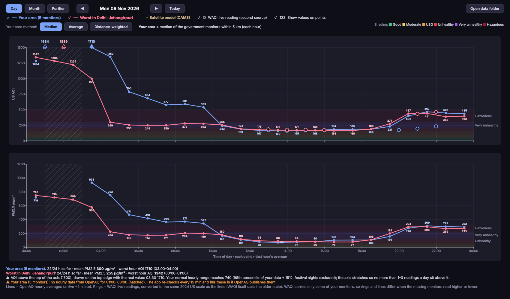
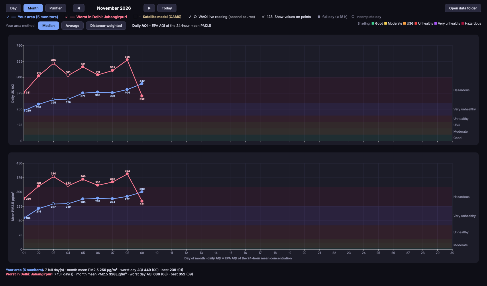
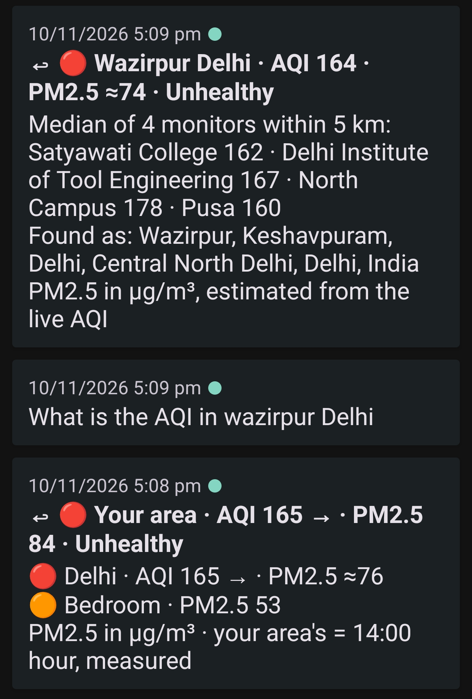
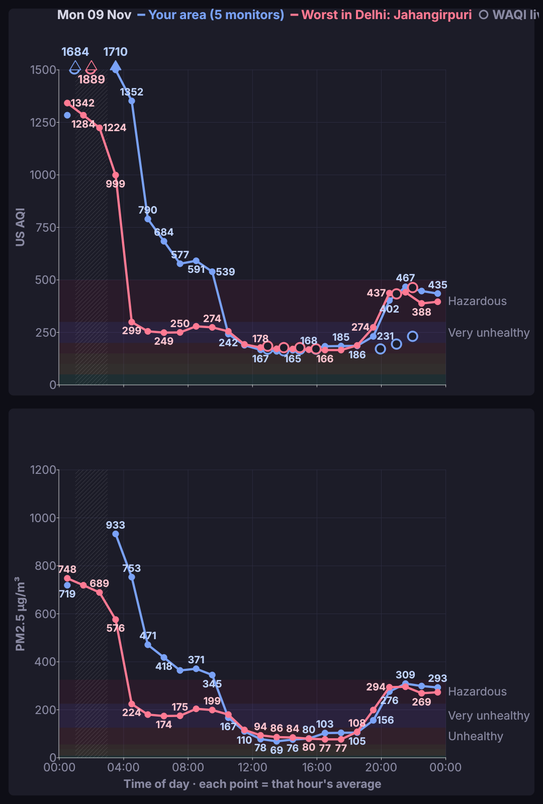
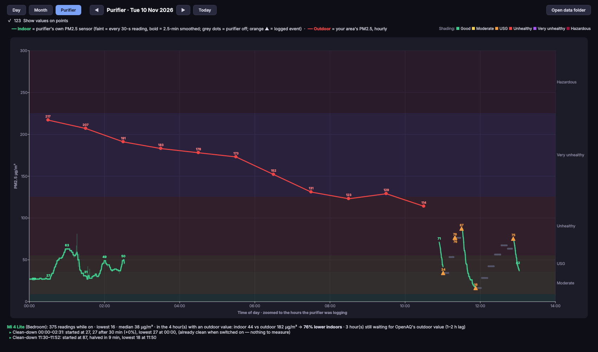
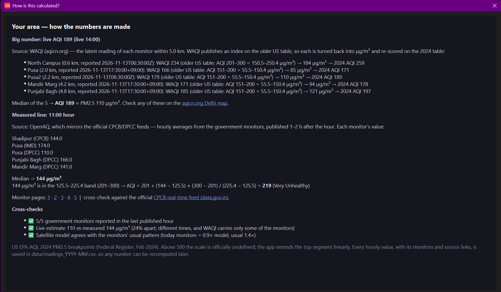

# AQI Dashboard v2: an air-quality monitor for Indian cities, built and tested in Delhi

> A Windows desktop app that records your neighbourhood's PM2.5 hour by hour, shows **what the air
> is doing now and how it got here**, explains **why** it got worse, sends updates to your phone, and
> shows how every number was worked out, so you don't have to take it on trust.


---

> **Works in any Indian city with public air-quality monitors** (and most cities worldwide): set your
> own location and it finds the government monitors around you. It was built and validated in
> Delhi, so the examples and numbers below come from there. See [Using it in your city](#using-it-in-your-city)
> for what changes, including the parts that are specific to North India.

## Why this exists

Air pollution is a year-round problem across India's cities, and in North India it becomes an
emergency every winter. Delhi, where this app was built, shows it most starkly: for about four
months every year, its air is among the worst measured anywhere. Crop-residue
smoke from Punjab and Haryana, winter temperature inversions that trap pollution near the
ground, traffic, construction dust and festival fireworks all add up, and they arrive on top of
an annual average that is already very high.

- Delhi's 2023 annual PM2.5 was **88.4 µg/m³**, about **18 times** the WHO guideline of 5 µg/m³. At
  that level the University of Chicago's Air Quality Life Index estimates residents lose about
  **8.2 years** of life expectancy. ([AQLI 2025](https://aqli.epic.uchicago.edu/post/delhi-residents-losing-8-2-years-of-their-lives-to-high-air-pollution-report-en))
- On Diwali night 2026, Delhi Pollution Control Committee data showed single stations above
  **3,000 µg/m³** of PM2.5. ([The Wire](https://m.thewire.in/article/environment/delhis-missing-diwali-night-pollution-data-released-pm2-5-crosses-3700-politicians-cling-to-superstition))
- In the neighbourhood this app was built for, the **mean PM2.5 on 9 Nov 2026 was 300 µg/m³**
  (22 of 24 hours published; the government monitors didn't publish the other 2) and the worst hour
  reached 933 µg/m³.

Checking an app once a day can't keep up with that. What does help is knowing **when** the air is
worst (often mid-morning and late evening, not only at night), **how today compares** with
yesterday and last year, and **whether a spike is city-wide or just your area**. That is what this app
records and shows.

### What PM2.5 does to the body

PM2.5 means particles under 2.5 micrometres, about 30 times thinner than a hair. They get deep
into the lungs and the smaller ones pass into the blood. Long-term exposure is linked to heart
disease, stroke, lung cancer, chronic lung disease (COPD), asthma attacks and lower-respiratory
infections. Short spikes worsen existing heart and lung conditions within hours. WHO's 2021
guidelines are **15 µg/m³ for a 24-hour average** and **5 µg/m³ for an annual average**, and WHO
estimates that meeting them would prevent most of the millions of deaths a year it attributes to
PM2.5. ([WHO guidelines via IQAir](https://www.iqair.com/newsroom/2021-WHO-air-quality-guidelines))

*This app gives information, not medical advice.*

---

## What this app is, and what it isn't

**It is a monitoring tool, not a certified instrument.** There's no sensor at your house. The app
combines public data from government monitors near you, a second live feed, and an independent
satellite-based model, and it is **open about how each number is made**:

- every number says **where it came from and when** (e.g. *"live 23:00"*, *"measured 21:00–22:00"*);
- one click shows **each monitor's raw reading and the exact formula** with the numbers plugged in;
- it **flags when sources disagree** or monitors go silent, so you know when to be careful.

It won't give you a lab-grade reading of your bedroom window. It will tell you reliably whether
today is worse than yesterday, whether the air is getting worse right now, and how bad it is
around you.

---

## v1 → v2

[v1](https://github.com/IshantNaru/AQI-dashboard/tree/v1.0) was a one-screen snapshot: the nearest
station's AQI plus a median across four websites. v2 is a recorder and analyst.

| | v1 | v2 |
|---|---|---|
| "Your area" | nearest single station | **median of all government monitors within 5 km**, with average and distance-weighted shown alongside, chosen by measured accuracy (below) |
| Units | AQI only | **PM2.5 in µg/m³ and AQI**, with every AQI computed from a concentration |
| AQI scale | mixed (sources used different US tables) | **one scale (US EPA 2024)**: WAQI's older-table numbers are converted back to µg/m³ and re-scored |
| Time | "now" | **live (with time) and measured (with the hour)** shown separately, plus full history |
| History | none | background recorder → monthly CSVs; **Day / Month graphs**; a saved image of every day |
| Gaps | invisible | missing monitor hours **marked on the graph and logged** |
| Independent check | none | **satellite-based model (Copernicus CAMS)**, unaffected by monitors going offline |
| Why is it bad? | n/a | **cause explainer**: festival calendar, city-wide vs local, wind, mixing height, smoke vs dust, crop-fire season |
| Alerts | none | spikes in your area or across your city → banner, sound, Windows notification, phone |
| Phone | none | **ntfy push updates every 2 h**, and you can **ask questions** ("why is it so bad?", "AQI in Rohini", "graph") |
| Indoor (optional) | none | smart purifier logging: indoor vs outdoor, clean-down time, door-opening detection |
| Trust | "median of 4 sources" | **"How is this calculated?"** on every card: raw values, formula, links, cross-checks |
| Accuracy testing | none | leave-one-out validation and fault-injection tests on your own recorded data |
| Past years | none | same-date comparison with earlier years from the government archive and the satellite model |

---

## Features

### 1. Dashboard: live and measured, never mixed

| Card | What it shows |
|---|---|
| **Your area** | **Live AQI** (big number, labelled *live HH:MM*), its PM2.5 (≈), and a separate **Measured** line: e.g. *"Measured 21:00–22:00: PM2.5 311 µg/m³ → AQI 471"* from the government monitors |
| **City overview** | WAQI's city station, converted to the same scale, *live HH:MM* |
| **Consensus** | median of independent feeds (government data, WAQI, OpenWeather's model, IQAir if configured) |

Below the cards: nearby stations, the worst 5 within 30 km, and a search for any locality ("AQI in
Karol Bagh").

**Why both live and measured?** Government hourly averages, mirrored by OpenAQ, are the official
numbers, but they are published **1–2 hours after the hour**. WAQI's live feed is current but
carries only some monitors. The app shows both, each labelled with its time, instead of blending
them into a single number that would mislead.

### 2. How the AQI is calculated

1. Start from **PM2.5 in µg/m³** (measured, or converted back from a source that only publishes an index).
2. Apply the **US EPA 2024 breakpoints** with the standard formula:
   `AQI = I_lo + (C − C_lo) × (I_hi − I_lo) / (C_hi − C_lo)`.
   For example, 311 µg/m³ falls in the 225.5–325.4 band (AQI 301–500), giving **AQI 471**.
3. **WAQI uses the older (pre-2024) US table.** Across 309 paired hourly readings from the same
   monitors, WAQI's numbers matched the old table to within a median 3 AQI points and the 2024 table
   only to within 26. So each WAQI number is converted back to µg/m³ using the old table, then
   re-scored on 2024. WAQI's original value is kept and shown for reference.
4. Above 500 the official scale ends. The app extends the top segment and says so wherever such
   values appear.

### 3. "Your area" = median of nearby monitors, and why median

Each hour, the app takes every government monitor within your radius (5 km by default, widened to
8 km if fewer than 2 report) and combines them three ways: **median**, **average**, and
**distance-weighted** (1/d²). You can switch between them in History.

It's tested, not assumed. **Leave-one-out cross-validation** hides one monitor at a time, predicts
it from the others, and measures the error: thousands of predictions on the app's own recordings
(826 hours, 4 Oct – 13 Nov 2026, 5 monitors):

| Method | Typical error (MAE) | If one monitor reads **half** (sprinklers nearby) | If one reads **double** (fire nearby) |
|---|---|---|---|
| **Median** | **37.2 µg/m³** | area value moves **7.3%** on average | **9.5%** |
| Average | 38.1 µg/m³ | 10.2% | 20.5% |
| Distance-weighted | 41.6 µg/m³ | 10.2% | 20.5% |

The median is the most accurate here **and** the hardest for one faulty or tampered monitor to pull
off course. The app re-runs these tests daily (`data/evaluation_report.txt`), and `method_test.py`
explains the method in full (see `METHOD_TEST.md`).

### 4. History graphs


*Diwali day, 9 Nov 2026. Hatched band = hours the government monitors didn't publish. The ▲ at the
top edge is an outlier drawn on the axis boundary with its real value (1710).*

- **Day view:** hourly AQI and PM2.5 for your area and for **your city's worst monitor of the last
  30 days** (picked automatically, re-picked monthly; "Worst in Delhi" in these screenshots). Values are printed on the points (labels move
  so they don't overlap), and WAQI live readings appear as rings.
- **Month view:** daily AQI (EPA method: AQI of the 24-hour mean), with full and incomplete days
  marked.
- **Sensible axis:** the axis is sized to *your* normal range (98th percentile of the last 90 days,
  festival nights excluded, plus an allowance). On a festival night, at most 1–3 extreme readings sit
  on the top edge with their values instead of squashing the whole chart.
- **Gaps are visible:** hours with no published data are hatched; hours not yet published are dotted.
- **Daily image:** each completed day is saved as a PNG the next morning, with a notification.



### 5. An independent check: satellite-based model

A dashed line on the PM2.5 chart shows **Copernicus CAMS** (via Open-Meteo, free). CAMS is an
atmospheric model corrected with **NASA MODIS satellite aerosol data**, and its global system doesn't
use ground monitors. ([CAMS method](https://acp.copernicus.org/preprints/acp-2020-467/acp-2020-467.pdf),
[Open-Meteo API](https://open-meteo.com/en/docs/air-quality-api))

- It's coarse (~45 km grid) and a model, so **use it for the trend, not the exact level**.
- The app tracks how many times higher the monitors read than the model. **If the monitors
  suddenly drop while the model rises, question the monitors.**
- History goes back to August 2022, so year-to-year comparisons don't depend on which monitors
  happened to be running.

### 6. Why not take government monitors at face value?

The data behind this app comes from CPCB/DPCC monitors, and most of the time it is the best
measurement available. But it has documented gaps, usually at the worst moments:

- **Diwali night 2026:** Delhi stations stopped reporting in the early hours. One analysis counted
  **255 missing station-hours (18%)** over 24 hours. CPCB said readings above 1,000 µg/m³ were
  *omitted* as outside the analysers' range, not lost.
  ([The Wire](https://m.thewire.in/article/environment/cpcb-air-pollutant-concentrations-omitted-why-thats-a-problem),
  [ThePrint](https://theprint.in/feature/theres-a-data-gap-in-delhis-post-diwali-pollution-picture/3093881/))
  This app's own record shows the same gap: no published data for its area from 01:00 to 03:00 that night.
- **Monitor siting and coverage:** a CAG audit tabled in April 2025 found monitors placed near trees,
  major roads and tall buildings, and data short of the required 16 hours a day.
  ([Tribune](https://www.tribuneindia.com/news/delhi/cag-report-flags-defects-in-monitoring-air-quality-data))
- **Allegations:** in December 2025 politicians alleged water was sprayed around some stations;
  CPCB's chairman denied any manipulation.
  ([Tribune](https://www.tribuneindia.com/news/delhi/cpcb-denies-aqi-data-tampering-allegations))

This app doesn't claim any of that is tampering. It's built so that **it doesn't matter**: the median
resists one odd monitor, gaps are shown instead of hidden, and the satellite model keeps the trend
visible if monitors go quiet.

### 7. "Why is the air like this?"

Every spike alert includes likely causes, and you can ask from the tray or phone. The explainer
uses rules, not an AI model, so every reason is shown with the evidence behind it:

- **Calendar:** Diwali (including the night before and two days of leftover smoke), Dussehra,
  Gurpurab, Holika Dahan, Lohri, New Year's Eve, plus your own `data/events.csv`.
- **Local or city-wide:** your area's change vs the median of all monitors in your city over the same 3 hours.
- **Weather (Open-Meteo):** wind speed and how much it dropped, mixing-layer height (a shallow
  layer traps smoke near the ground), fog, rain.
- **Smoke or dust:** the share of PM10 that is PM2.5.
- **Crop-burning season** (North India only: Punjab, Haryana, Delhi-NCR, UP up to about Lucknow, northern
  Rajasthan): Oct–Nov
  with a north-westerly wind, plus fire counts from NASA FIRMS if a free key is set. Skipped elsewhere.

> Example of the format: *Likely: city-wide (Delhi median AQI 170 → 390) · wind dropped from 11 to
> 3 km/h · shallow mixing layer (100 m) · mostly fine particles (PM2.5 is 79% of PM10)*

### 8. Alerts

A jump of ≥100 µg/m³ in an hour, crossing 250 µg/m³, a city-wide jump, or a live-reading spike
triggers a closable banner, a sound, a Windows notification when the app is in the background, and
a phone push. Each hour is judged once, so restarts never repeat an alert. Everything is logged to
`data/alerts.csv`.

### 9. Phone updates and questions (ntfy)

[ntfy](https://ntfy.sh) is a free push-notification app (Android and iPhone, no account). The
dashboard posts to a private topic you subscribe to:

- **An update every 2 hours**, colour-coded:
  `🟣 Your area · AQI 334 ↑12 (live 23:00) · PM2.5 ≈242 · Hazardous`
  `📏 Measured 21:00–22:00 · PM2.5 311 → AQI 471`
- **Surge alerts** with their likely cause, at high priority.
- **Ask in plain words** in the ntfy app. The dashboard picks out keywords; no AI model involved:

| You type | Reply |
|---|---|
| "what's the AQI right now?" | the current update |
| "why is it so bad?" | the likely causes |
| "AQI in Karol Bagh" | that locality, from its nearby monitors |
| "how is my room?" | indoor reading (if you have a purifier connected) |
| "show today's graph" / "purifier graph" / "graph of the month" | a chart picture, sized for a phone |
| "help" | the command list |

 

The messages are sent by the app on your PC: **the PC has to be on** for updates and replies. Anyone
who knows your topic name can read it, so the app generates a long random one, and phone commands
are read-only.

### 10. Optional: smart air purifier (indoor air)

*Only if you own a compatible smart purifier that can be read over your home Wi-Fi with its device
token (tested with Xiaomi Mi Air Purifier 4 Lite via `python-miio`).*

- Logs the purifier's own PM2.5 sensor every 30 s to `data/indoor_YYYY-MM.csv`, tagged with room
  (editable), mode and humidity.
- **Purifier graph:** indoor vs outdoor on one chart, "% lower than outdoor", and how fast each
  switch-on cleaned the room (e.g. *"started at 87, halved in 9 min"*).
- Detects sustained rises (door opened, cooking) while ignoring the sensor's own jitter. Pausing,
  and backing off when you're away from home, are handled automatically.



### 11. Offline and online

| Without internet | Needs internet |
|---|---|
| Starts and shows the last good reading (cached) | Live readings, recorder sync, satellite model |
| All History graphs and daily images (local CSVs) | Phone updates and replies |
| Purifier logging (home Wi-Fi only) | Locality search, cause explainer's weather data |

The recorder back-fills missed hours when the connection returns, so a night with the PC off
doesn't leave a gap.

### 12. Compare with past years

`Compare past Novembers.bat` (or `python history_compare.py`) pulls the same weeks of the last
three years from the government archive (OpenAQ, including retired sensor IDs) plus the satellite
model, and prints a same-date comparison: average, worst day, hours in the "Hazardous" band.

---

## Screenshots

| | |
|---|---|
|  | **"How is this calculated?"**: each monitor's raw reading, the conversion and formula with numbers, source links, and cross-checks (monitors reporting, live vs measured, satellite model vs usual ratio) |

---

## Setup

**Requirements:** Windows 10/11 and Python 3.10+ from [python.org](https://python.org) (not the
Microsoft Store version).

```cmd
git clone https://github.com/IshantNaru/AQI-dashboard.git
cd AQI-dashboard
setup_venv.bat              :: creates .venv, installs everything, registers autostart
copy config.example.json config.json
notepad config.json         :: add your keys and location
"Start AQI Dashboard.bat"
```

`setup_venv.bat` also installs the optional purifier library. If you don't need it, plain
`pip install -r requirements.txt` is enough.

### Keys (all free)

| Key | Needed for | Get it |
|---|---|---|
| `waqi_token` | **required**: live readings | [aqicn.org/data-platform/token](https://aqicn.org/data-platform/token/) |
| `openaq_key` | **recommended**: hourly government data, recorder, History | [explore.openaq.org](https://explore.openaq.org) → API keys |
| `openweather_key` | optional: model reading in Consensus | [openweathermap.org/api](https://openweathermap.org/api) |
| `iqair_key` | optional | [iqair.com](https://www.iqair.com/us/commercial-air-quality-monitors/api) |
| `firms_map_key` | optional: crop-fire counts in the cause explainer | [NASA FIRMS](https://firms.modaps.eosdis.nasa.gov/api/area/) |

The satellite model (Open-Meteo) and weather need no key.

### Location

Set `location.lat` / `lng` / `city` to your own and leave `"auto": false` (IP geolocation in India is
unreliable). See [Using it in your city](#using-it-in-your-city).

### Phone (optional)

Add to `config.json`, install **ntfy** on your phone, tap **+** and subscribe to the same topic:

```json
"phone": { "enabled": true, "topic": "aqi-<long-random-string>", "priority": 4 }
```

Then send a test from the tray icon → **Send test message to phone**.

### Smart purifier (optional)

Get the device's IP and token (e.g. with a Xiaomi cloud token extractor), check it with
`python purifier_probe.py --ip <IP> --token <TOKEN>`, then add an `"indoor"` block (see the top of
`indoor.py`). The token stays in `config.json`, which is never committed.

---

## Using it in your city

Set three things in `config.json` and the rest follows:

```json
"location": { "auto": false, "city": "Mumbai", "lat": 19.0760, "lng": 72.8777 }
```

| What | Where it comes from | Anything to change? |
|---|---|---|
| **Your area** | government monitors within `recorder.home_area.radius_km` (default 5 km) of your location | Raise the radius to 8–10 km in cities with fewer monitors. "Your area" needs at least 2 within `max_radius_km`. |
| **City-wide comparison and alerts** | all monitors in a box about ±28 km around your location, labelled with `location.city` | Optional `"city_box": [lat1, lng1, lat2, lng2]` to match your city's outline exactly |
| **"Worst in your city" line** | `recorder.tracked_station`. If you delete that block, it uses your location and city name | `name_filter` must match how monitor names spell the city, e.g. "Bengaluru", not "Bangalore" |
| **Satellite model, weather, festivals** | your coordinates; Indian festival calendar plus your own `data/events.csv` | none |
| **Crop-burning check** | only runs for the north Indian plains (lat 25–32.5°N, lng 73.5–84.5°E) | `"stubble_check": true/false` to force it on or off |

Monitor coverage differs a lot between cities. Delhi has dozens of government monitors; many
smaller cities have only a handful. With fewer monitors, "your area" covers a wider radius and the
satellite model becomes more useful as a cross-check.

---

## Accuracy and limits

- **No sensor at your house:** "your area" is estimated from monitors 0.5–5 km away. A busy road
  outside your window can be worse.
- **Shared bias is invisible:** if every monitor reads low together, no method that uses only those
  monitors can tell. The satellite model is there to catch that kind of drift in the trend.
- **The live feed carries only some monitors**, so live and measured can differ. The card shows both,
  and the cross-check flags gaps above 30%.
- **The satellite model is coarse** (~45 km) and, in Delhi's winter, often reads well below the
  ground monitors. Use it for direction, not level.
- **Above AQI 500** the US scale is undefined; values are extended, not official.
- **Purifier sensors** are low-cost laser sensors: fine for trends and comparisons, not reference-grade.

---

## Your data stays on your PC

`config.json` (keys, tokens, phone topic), `data/` (recordings, indoor logs) and logs are in
`.gitignore` and never leave your machine, except for the requests the app makes to the data
sources and, if you enable it, the messages it sends to your ntfy topic.

---

## Project structure

```
aqi-dashboard/
├── dashboard.py           # main window, tray, cards, alerts banner, phone integration
├── history_panel.py       # Day / Month / Purifier graphs, outlier axis, label layout, phone renders
├── recorder.py            # background recorder: OpenAQ hourly + WAQI live → monthly CSVs, daily stats
├── aqi_math.py            # EPA 2024 PM2.5 ↔ AQI, WAQI older-table conversion
├── cards.py               # live vs measured values for the cards and phone
├── verify.py              # "How is this calculated?" + cross-checks
├── area.py                # live area reading: median / average / distance-weighted
├── cams.py                # satellite-based model (Copernicus CAMS via Open-Meteo)
├── surge.py               # cause explainer + city-wide snapshots
├── alerts.py              # spike alerts (area, live, city-wide)
├── phone.py               # ntfy updates, alerts, keyword commands
├── indoor.py              # optional smart-purifier logging
├── evaluate.py            # daily accuracy / robustness / data-health report
├── method_test.py         # leave-one-out + fault-injection tests (see METHOD_TEST.md)
├── history_compare.py     # same dates, past years (monitors + satellite model)
├── waqi.py · openaq.py · openweather.py · iqair.py · aggregator.py · geocoder.py
├── purifier_probe.py · purifier_net_check.py   # purifier connection helpers
├── setup_venv.bat · Start AQI Dashboard.bat · setup_autostart.py · uninstall_autostart.py
└── config.example.json
```

---

## Transparency disclaimer

**This app was built with AI (Claude by Anthropic) as the main implementation tool, in v1 and v2.**

What I did: defined what the app had to answer from living with Delhi's air, made the
design calls (median over nearest station, live vs measured kept apart, an independent satellite
check, showing every calculation), tested every build on real days, caught what was wrong (mixed
AQI scales, misleading cards, false door-opening alerts, unreadable graphs) and set the bar for what
counted as correct. The Python was written by Claude under that direction.

If you're evaluating this as a portfolio project: it shows product thinking, data-quality judgement
and the ability to ship and validate a real tool end to end. It is not evidence of hand-written
Python.

---

## Sources

- AQLI 2025, Delhi life expectancy: <https://aqli.epic.uchicago.edu/post/delhi-residents-losing-8-2-years-of-their-lives-to-high-air-pollution-report-en>
- WHO 2021 air quality guidelines (summary): <https://www.iqair.com/newsroom/2021-WHO-air-quality-guidelines>
- US EPA 2024 PM2.5 AQI breakpoints: <https://www.epa.gov/system/files/documents/2024-02/pm-naaqs-air-quality-index-fact-sheet.pdf>
- Diwali 2026 data omission and CPCB response: <https://m.thewire.in/article/environment/cpcb-air-pollutant-concentrations-omitted-why-thats-a-problem>
- Post-Diwali data gap: <https://theprint.in/feature/theres-a-data-gap-in-delhis-post-diwali-pollution-picture/3093881/>
- CAG audit of monitoring: <https://www.tribuneindia.com/news/delhi/cag-report-flags-defects-in-monitoring-air-quality-data>
- CPCB denial of tampering allegations: <https://www.tribuneindia.com/news/delhi/cpcb-denies-aqi-data-tampering-allegations>
- Copernicus CAMS assimilation (MODIS AOD): <https://acp.copernicus.org/preprints/acp-2020-467/acp-2020-467.pdf>
- Open-Meteo Air Quality API: <https://open-meteo.com/en/docs/air-quality-api>
- Data: OpenAQ (government monitors), WAQI / aqicn.org, OpenWeather, Copernicus CAMS, NASA FIRMS.
